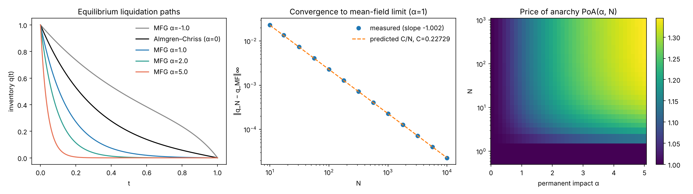

# Mean-Field Games of Optimal Execution

Closed-form Nash and mean-field equilibria for **crowded liquidation**: many traders unwinding the same position, where everyone's selling moves the price through permanent impact.

This project extends the Almgren–Chriss optimal execution problem to an N-player game and its mean-field limit, following the setup of Cardaliaguet & Lehalle (2018). Every result is proved analytically in the [report](report/report.pdf) and checked numerically in this repo.



## Model

Each trader liquidates inventory $q(0)=Q$ to $q(T)=0$ at rate $\nu=q'$. The price drifts with the **average** trading rate $\mu$ (permanent impact $\alpha$), and trading pays temporary impact $\kappa$ and a risk penalty $\phi$:

$$dS_t=\alpha\,\mu_t\,dt+\sigma\,dW_t,\qquad
\min_q\ \int_0^T\left(\kappa q'^2+\phi q^2\right)dt-\alpha\int_0^T q\,\mu\,dt .$$

## Results

| # | Result | Statement |
|---|--------|-----------|
| 1 | Lone trader | Permanent impact contributes only a boundary term, so N = 1 reduces to Almgren–Chriss |
| 2 | Reduction | Every open-loop Nash equilibrium is symmetric and solves $q''+aq'-k^2q=0$, with $a=\frac{\alpha}{2\kappa}(1-\frac1N)$ |
| 3 | Closed form | $q_N(t)=Q\,e^{-at/2}\,\frac{\sinh(\omega(T-t))}{\sinh(\omega T)}$, $\omega=\sqrt{a^2/4+k^2}$. The equilibrium exists and is unique for every $\alpha\in\mathbb{R}$ |
| 4 | Front-loading | For $\alpha>0$, crowded traders hold strictly less inventory than Almgren–Chriss at every $t\in(0,T)$ |
| 5 | Inefficiency | The social optimum is Almgren–Chriss. Equilibrium excess cost is $\ge 0$ for all $\alpha$, and there is a closed-form price of anarchy |
| 6 | Convergence | $\lVert q_N-q_\infty\rVert_\infty = C/N + O(N^{-2})$, with $C$ explicit |

### Numerical checks ($T=Q=1,\ \kappa=0.1,\ \phi=1$)

| Check | Value |
|-------|-------|
| Closed form vs. `scipy.integrate.solve_bvp` (max rel. error) | 5.8 × 10⁻¹⁴ |
| Inventory sold by T/2: Almgren–Chriss vs. mean field (α = 1) | 80.3% vs. 96.2% |
| Price of anarchy at α = 1, 2, 5 (N → ∞) | 1.105, 1.208, 1.345 |
| Convergence slope (log‖q_N − q_∞‖ vs. log N) | −1.002 |
| Leading constant: predicted vs. measured at N = 10⁶ | 0.2272875 vs. 0.2272876 |

## Repository layout

```
src/mfg.py              closed-form solutions, BVP solver, costs, price of anarchy
scripts/verify.py       prints every numerical check above
scripts/make_figures.py regenerates figures/mfg_results.png
tests/test_theorems.py  one pytest test per theorem (60 cases)
report/report.pdf       full write-up with proofs
```

## Run it

```bash
pip install -r requirements.txt
python scripts/verify.py
python scripts/make_figures.py
pytest -q
```

## Limitations

Strategies are open-loop and deterministic, impact is linear, and traders are homogeneous. Closed-loop equilibria, heterogeneous inventories (which lead to a forward–backward ODE) and a proof of back-loading for α < 0 are natural next steps.

## References

- R. Almgren and N. Chriss. Optimal execution of portfolio transactions. *Journal of Risk*, 2001.
- P. Cardaliaguet and C.-A. Lehalle. Mean field game of controls and an application to trade crowding. *Mathematics and Financial Economics*, 2018.
